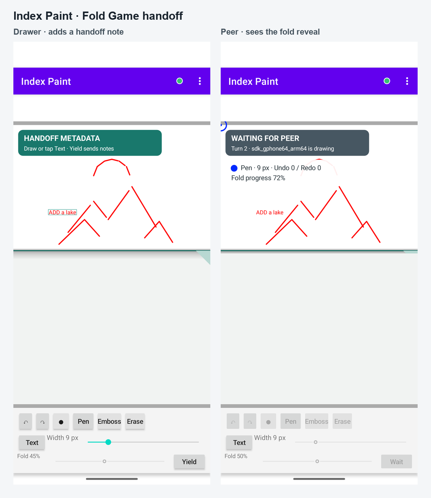

# Index Paint

Index Paint is an Android app for two people to draw together on one shared canvas. It is built with Kotlin and currently connects nearby devices over Bluetooth Classic. Strokes and session data go directly to the connected peer; the app has no drawing server.

The original idea is a shared, turn-based drawing game: one person starts a picture and the other continues it. **Fold Game** makes that handoff visible: the drawer chooses where to fold, can leave optional drawn or typed notes outside the final picture, and yields the turn. The next person sees the revealed portion and continues. Finishing is acknowledged by both people. **Free Draw** shares a canvas without the fold rules.

Other tools include color and brush selection, erasing, undo and redo, movable text, A4/Letter paper, zoom, and saving the canvas as a PNG. The drawing protocol is separated from the Bluetooth transport so another transport could be added later; Bluetooth is the only transport implemented today.

## Project story

I started this project in Android's very early years—probably around 2008 or 2009, though I no longer remember the exact year. It stayed unfinished for a long time. In 2026 I came back to the original idea, moved the app to Kotlin, and streamlined it. It is still a work in progress.

## Build

### Requirements

- JDK 17
- Android SDK Platform 36
- Android SDK Command-line Tools (or Android Studio's SDK Manager)

With `sdkmanager` available, install the platform with:

```sh
sdkmanager "platforms;android-36"
```

The Gradle wrapper downloads the project's Gradle version automatically. Android Studio can open this repository directly, or build it from a terminal:

```sh
git clone https://github.com/ede73/IndexPaint.git
cd IndexPaint
./gradlew assembleDebug
```

The debug APK is written to `app/build/outputs/apk/debug/app-debug.apk`. To install it on a connected Android device or emulator:

```sh
./gradlew installDebug
```

For emulator-to-emulator play, start two Android emulators, pair them in Android Settings, open Index Paint on both, and connect from one app. Both people must choose the same session mode before the game starts. Bluetooth behavior depends on the emulator image and host setup; physical Android devices are the intended use.

### Signed release builds and Internal testing

Signed releases are built by the Mac mini GitHub Actions workflow described below. On this trusted repository's pull request from `ede73`, it runs the signed AAB build only, before merge. After merge, it can also be manually triggered on `main`; publishing remains opt-in. The runner gets the upload keystore and its GitHub-specific passwords from repository Actions secrets for that job, creates a signed AAB, then removes its temporary signing files. Do not commit a keystore or signing passwords.

The AAB is checked against the configured signing certificate and uploaded as a seven-day workflow artifact. A normal build does not publish to Google Play. Publishing is a separate action enabled only by the workflow's `publish_internal` input.

#### Google Play publishing setup (when we enable publishing)

Publishing is a separate step from building/signing an AAB. It needs one Google Play service-account credential with permission to release to testing tracks. It does not need your Google account password, and it is separate from the Android upload keystore and its passwords.

When we are ready to enable publishing:

1. In [Google Cloud Console](https://console.cloud.google.com/), select or create a Cloud project, then enable **Google Play Android Developer API** in **APIs & Services → Library**. Google currently says the Cloud project does not need to be linked to the Play developer account.
2. In **IAM & Admin → Service Accounts**, create a service account (for example, `indexpaint-play-upload`). Do not grant it broad Cloud project roles such as Owner; Play Console permissions control its Play access.
3. Create a **JSON key** for the service account and download it. This JSON file contains a private credential. Keep it out of the repository, messages, and build artifacts.
4. In [Play Console](https://play.google.com/console/), invite the service account email under **Users and permissions**. Grant app access to IndexPaint and **Release apps to testing tracks**. Do not grant Production release or account-admin permissions. See Google's [API setup guide](https://developers.google.com/android-publisher/getting_started) and [permission reference](https://support.google.com/googleplay/android-developer/answer/9844686?hl=en).
5. Add the JSON file contents as the repository Actions secret `ANDROID_PUBLISHER_CREDENTIALS` (Repository → **Settings → Secrets and variables → Actions → New repository secret**). Do not add it as a variable or commit it. GitHub CLI can also set it by reading the file: `gh secret set ANDROID_PUBLISHER_CREDENTIALS < /path/to/service-account.json`.
6. The Android application ID (`fi.iki.ede.IndexPaint`) and Play track name (`internal`) are identifiers, not credentials; they do not need to be secret. The workflow already targets the Internal testing track and only publishes when the `publish_internal` input is enabled.

The service-account JSON is the only additional Play publishing secret. The workflow exposes it only to the publishing step. GitHub does not show a saved secret value again, so keep the downloaded JSON only until it has been entered successfully, then delete that local download. If it is lost later, create a replacement JSON key and update the GitHub secret.

#### Mac mini build through GitHub Actions

The [`Android Mac mini build`](.github/workflows/android-mac-mini.yml) workflow runs on a self-hosted Mac runner. Pull requests by `ede73` to `main` run a build-only signed AAB verification before merge. Manual dispatch on `main` can build, or publish to Internal testing if `publish_internal` is explicitly enabled. GitHub supplies the repository's signing secrets to the job; the runner decodes the upload keystore into a temporary file, signs the AAB locally, uploads the AAB as a seven-day workflow artifact, then removes the keystore and checked-out workspace. The runner uses the job-provided signing secrets and does not depend on a macOS credential store.

The helper writes these three **repository** Actions secrets for signing IndexPaint:

- `INDEXPAINT_UPLOAD_KEYSTORE_BASE64`: the CI-only copy of the upload keystore, encoded as base64.
- `INDEXPAINT_KEYSTORE_PASSWORD`: a fresh random password for the CI keystore copy.
- `INDEXPAINT_KEY_PASSWORD`: a separate fresh random password for its private-key entry.
- `ANDROID_PUBLISHER_CREDENTIALS`: the Google Play service-account JSON, only needed if you choose `publish_internal`.

To create and upload the CI-only keystore copy and its passwords, run this from the project checkout after `gh` is authenticated:

```sh
./scripts/update-github-signing-secrets.sh [path/to/original-upload.jks]
```

The path is optional; without it, the script asks for the file and retries if it cannot find it. It checks `gh auth status`, required commands, and access to repository secrets and variables before asking for the keystore passwords. It uses `keytool` to make a temporary copy with two independent random shell-safe passwords, then verifies the copy's new passwords and matching signing certificate before confirmation. It sets three separate GitHub Actions secrets for the copied JKS, store password, and private-key password, plus repository variables for the alias and keystore type. If any write fails, the script stops and tells you to rerun it from the unchanged local JKS before building; the rerun overwrites all three secrets. On success, it removes the obsolete single secret left by an earlier helper version. The new passwords are not displayed or written to a file by the script; they are held briefly in process memory. Temporary cleanup is checked and a remaining temporary-directory path is reported if removal fails. The original keystore is left untouched. Keep GitHub Actions secrets specific to each repository.

The workflow exposes the Play credential only to the publish step.

## Screenshots

Fold Game across two Bluetooth-connected emulators: the drawer adds a handoff note beside the adjustable fold, while the peer sees the revealed drawing and waits for their turn. The note is guidance for the next drawer; it stays outside the finished picture.



## Privacy

Index Paint has no account system, advertising, analytics SDK, or developer-operated server. When connected, drawing and session content is sent directly to the Bluetooth peer. Drawings stay on the device unless the user saves or shares them.

## License

Index Paint's original project code is licensed under the MIT License; see [LICENSE](LICENSE). Portions adapted from the Android Open Source Project BluetoothChat sample and the included Gradle wrapper retain their Apache License 2.0 terms. See [THIRD_PARTY_NOTICES.md](THIRD_PARTY_NOTICES.md) and [LICENSE-APACHE-2.0](LICENSE-APACHE-2.0). Existing source-file notices remain in place.
